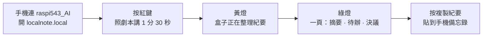

# LocalNote Pi Demo 版 · UI 變更說明

2026-10-07 · 目標 10/12 前完成 · 原則：不動架構、不換模型、只改介面與提示詞
對應 UI 稿：畫布「LocalNote Pi Demo UI 修改版」與《Demo版UI修改版.png》，綠色編號 1–6 即本文件各節

## 風格原則

頁面是給客戶看的，不是給工程師看的。四條：
- 淺色底、白卡片、一個主色（綠）、一個動作色（紅錄音鍵）。
- 技術字眼不上畫面：IP、MAC、RAM、RTF、模型名都不出現；要講就用人話（「盒子正在整理紀要」）。
- 一屏只有一個主動作：大紅「開始錄音」鍵。
- 狀態用顏色加一句話：紅 錄音中、黃 整理中、綠 完成。

## 區塊分三類：操作、輸出、設定

頁面上每個區塊都貼一個標籤，客戶一眼知道哪裡能按、哪裡是結果、哪裡不用碰。

| 標籤 | 樣式 | 意思 | 放哪 |
|---|---|---|---|
| 操作 | 綠色標籤；卡片綠色粗邊、白底、有陰影 | 你按的。整頁只有一張 | 左欄上方 |
| 輸出 | 深藍標籤；卡片左側深藍粗線、白底 | 盒子給你的。只讀，頂多複製 | 右欄 |
| 設定 | 灰色標籤；卡片灰底、虛線邊、字小一號 | 平常不用動 | 左欄下方 |

| 區塊 | 類別 | 為什麼歸這類 |
|---|---|---|
| 錄一段會議（紅鍵、時長、進度） | 操作 | 唯一的主動作。時長雖是選項，但每次錄前都要看一眼，跟著操作走 |
| 會議紀要（摘要、待辦、決議、逐字稿） | 輸出 | 盒子算出來的結果。「複製」「重新整理」是對結果的動作，留在卡片右上 |
| 翻成英文、唸給我聽 | 輸出 · 加分項 | 以紀要為輸入再生成，仍是結果；邊線用淺藍，比紀要低一階 |
| 手機怎麼連（Wi-Fi、掃碼、切回家用） | 設定 | 連上一次就不用再看 |
| 耳麥（找、連、中斷） | 設定 | 開機連好就不碰 |
| 頂部狀態（離線運作、負載溫度） | 狀態 | 不是卡片，是常駐指示，標「狀態」兩個字即可 |

視覺規則：操作卡最重（粗邊 + 陰影），輸出卡次之（左側色線），設定卡最輕（灰底虛線）。三種標籤顏色明度不同，色盲也分得開。

## 總覽

| # | 改什麼 | 為什麼 | 工時 | 負責 |
|---|---|---|---|---|
| 1 | 熱點直連；標題改「離線運作 · 資料不出盒子」；加連線掃碼 | 現在寫「Online Gateway」是「不連雲」的反證 | 0.5 天 | 系統 |
| 2 | 技術數字改成一句狀態話 | 讓客戶看懂盒子在做什麼 | 2 小時 | 系統 |
| 3 | 開發工具移出演示頁 | 開發工具不給客戶看 | 1 小時 | 前端 |
| 4 | 大紅錄音鍵；時長 1–3 分鐘；加整理進度 | 10 秒錄不完一段會議；客戶要知道盒子在算 | 0.5 天 | 前端 + 後端 |
| 5 | 右側改成一頁紀要；加「複製紀要」 | 這是閉環的最終產物，現在沒有 | 1 天 | 後端 |
| 6 | 翻譯與朗讀收合在下方 | PRD 不做翻譯，但程式已有，留作加分項 | 1 小時 | 前端 |

合計約 2.5–3 天。10/7 開工，10/10 排練，10/11 備機。

---

## 1. 熱點直連，標題改「離線運作」，加掃碼

**現狀**：STA 家用 Wi-Fi 模式，顯示 IP，標題「Online Gateway」，有「切換為方案 A 熱點」按鈕。

**改成**
- 演示預設走熱點 `raspi543_AI`，開機即啟動。手機連這個 Wi-Fi，瀏覽器開 `localnote.local`（mDNS，比 IP 好記；不通就退回 192.168.4.1）。
- 頂部標籤：熱點模式顯示綠色「離線運作 · 資料不出盒子」；家用 Wi-Fi 模式顯示灰色「維護模式」。
- 頁面加一塊「手機怎麼連」：一句話 + 一個 Wi-Fi QR Code。QR 內容是 `WIFI:T:WPA;S:raspi543_AI;P:<密碼>;;`，手機相機掃了直接連。QR 圖產一次存成靜態圖，不用程式產。同一張貼在盒子上。
- 原切換按鈕保留，改名「維護：切回家用 Wi-Fi」，放到角落。

**判斷離線的方法**：後端每 10 秒檢查預設路由或 ping 一次外網，失敗即「離線」。不用熱點開關狀態推斷。

**要先測的**：熱點開著時藍牙耳麥會不會卡。Pi 5 的 Wi-Fi 和藍牙共用天線。會卡就把熱點改 5 GHz；還卡就買一台旅行路由器不插 WAN，Pi 用網路線接。

---

## 2. 技術數字改成一句狀態話

**現狀**：Temp 44.5°C、RAM 14.8 / 15.8 GB。

**改成**
- 一個灰色膠囊：「盒子狀態：待命 · 負載 6% · 44°C」。處理時變「盒子狀態：整理中 · 負載 98% · 52°C」。
- 負載讀 `/proc/stat`，每 2 秒刷新。錄音處理時會衝到 90–100%，演示時指給客戶看。
- RAM 不顯示。14.8 / 15.8 GB 多半是 Linux 檔案快取，客戶看了會以為盒子快爆了。

---

## 3. 開發工具移出演示頁

**現狀**：分頁「程式碼審查與 LLM Arena」、按鈕「Code Review (/dbg01)」「API Docs」都在首頁。

**改成**
- 預設只有「會議聽記」一個頁面，連分頁列都不要。
- 網址帶 `?dev=1` 才顯示開發分頁和按鈕。前端 CSS 控制即可，不動路由。
- 標題「Edge AI & Bluetooth Voice Gateway」改「LocalNote 聽記盒」，副標「會議錄音，紀要在盒子裡生成」。

---

## 4. 大紅錄音鍵，時長 1–3 分鐘，加整理進度

**現狀**：下拉「10 秒（推薦 /voice 10 標準）」，藍色長條按鈕「開始耳麥錄音」。

**改成**
- 一顆 132 px 的紅色圓鍵「開始錄音」，頁面唯一的大動作。
- 下拉「這次錄」：1 分鐘 / 1 分 30 秒（演示）/ 2 分鐘 / 3 分鐘，預設 1 分 30 秒。去掉 `/voice 10`。
- 說明一句：「戴上耳麥，按下紅色按鈕開始說。時間到自動停，盒子接著整理成紀要。」
- 耳麥連線狀態縮成右上一個綠點膠囊「耳麥 RichChipAN 已連線」。耳麥管理（找耳麥、連線、中斷）降到下方小卡，不動邏輯。
- 鍵下方一個狀態區，三態：
  - 紅「錄音中 00:37 / 01:30」，倒數。
  - 黃「盒子正在整理紀要 · 還要約 50 秒」，進度條，下行「錄音完成 ✓ → 聽寫完成 ✓ → 整理紀要…」。
  - 綠「完成」，右側紀要同時出現。
- 處理順序：錄音 → whisper 轉寫 → LLM 生成紀要。轉寫完先把逐字稿送到前端，紀要生成完再送紀要。客戶先看到字，等待感短。

**不做**：開始 / 停止兩態、任務佇列、背景處理。固定時長夠演示。

**要先測的**：whisper 轉 90 秒音檔實際幾秒。超過 60 秒就把模型降一級（small → base）。目標：錄音結束到紀要出現 ≤ 90 秒。

---

## 5. 右側改成一頁紀要，加「複製紀要」

**現狀**：右側兩個框：「語音轉錄（WHISPER STT 繁體中文）」「即時道地英文（ENGLISH TRANSLATION）」。LLM 只做翻譯。

**改成**
- 右側主卡「會議紀要」，旁邊一個小標籤「盒子生成，未上傳」。固定四塊：
  1. 標題：會議名 · 日期時間 · 時長
  2. 摘要：3 條
  3. 待辦：表格，事項 / 負責人 / 時間
  4. 決議：1–3 條
- 「完整逐字稿」放卡片底部，預設收合。
- 右上兩個按鈕：「重新整理」（只重跑 LLM，不重錄）、「複製紀要」（複製 Markdown 到剪貼簿）。
- 用現有的本地 LLM，只換提示詞。固定輸出繁體中文。
- 只做一個模板「會議紀要」。客戶拜訪、備忘兩個模板下一版。

**提示詞骨架**（研發自行調）
```
你是會議記錄員。根據下面的逐字稿，用繁體中文輸出：
## 摘要
3 條，每條不超過 25 字
## 待辦
表格三欄：事項｜負責人｜時間。逐字稿裡沒提到負責人或時間就寫「待定」
## 決議
1–3 條，只寫已經定下來的事
不要加任何開場白或結尾。
逐字稿：
{transcript}
```

**複製紀要的內容**：四塊的 Markdown，第一行是標題。手機瀏覽器 `navigator.clipboard.writeText` 要在按鈕點擊事件裡呼叫才會成功。

---

## 6. 翻譯與朗讀收合在下方

**現狀**：「手動文字即時翻譯與語音合成」佔右側半屏。

**改成**
- 移到紀要卡下方，標題改「翻成英文、唸給我聽」，預設收合。
- 「紀要翻成英文」輸入來源預設是剛生成的紀要，不用手打。
- 「英文翻成中文」「在耳麥唸出來」不動。

---

## 演示閉環流程

四條線，每條都從客戶看到的東西開始。老闆按順序走 A，B 穿插在 A 的第 1 步，C 和 D 看現場氣氛。

### A. 主閉環：錄一段會議，拿到一頁紀要（4 分鐘）



| 步 | 老闆做 | 客戶看到 | 盒子做 | 時間 |
|---|---|---|---|---|
| 1 | 請客戶掃盒子上的 QR，或連 Wi-Fi `raspi543_AI`，開 `localnote.local` | 自己手機上出現頁面，頂部綠字「離線運作 · 資料不出盒子」 | 熱點 + 網頁 | 30 秒 |
| 2 | 戴耳麥，選「1 分 30 秒」，按紅鍵，照劇本講。劇本含 2 條待辦，各有負責人和時間 | 紅點倒數 | 錄 WAV | 90 秒 |
| 3 | 指著狀態列「負載 98%」 | 黃色進度條「盒子正在整理紀要」；逐字稿先出現 | whisper 轉寫 → LLM 生成 | 約 60 秒 |
| 4 | 讀摘要和兩條待辦 | 一頁紀要，待辦有負責人和時間 | — | 30 秒 |
| 5 | 按「複製紀要」，貼到手機備忘錄給客戶看 | 紀要在客戶自己的手機裡 | 複製 Markdown | 15 秒 |

### B. 證明離線：穿插在 A 的第 1 步（1 分鐘）


| 步 | 老闆做 | 客戶看到 |
|---|---|---|
| 1 | 舉起盒子：「沒有 SIM 卡，沒插網路線。」 | 一個小盒子，一條電源線 |
| 2 | 請客戶在自己手機開任何網站 | 打不開 |
| 3 | 指頁面頂部 | 「離線運作 · 資料不出盒子」 |
| 4 | A 第 3 步時指狀態列 | 「負載 98%」，算力在盒子裡 |

### C. 重新整理：同一段錄音，再出一次（1 分鐘）


| 步 | 老闆做 | 客戶看到 | 盒子做 |
|---|---|---|---|
| 1 | 「如果想換個寫法，不用重錄。」按「重新整理」 | 黃色進度，逐字稿不動 | 只重跑 LLM |
| 2 | 等約 30 秒 | 新一版紀要 | — |

用途：回答「寫得不好怎麼辦」。也是下一版「換模板」的入口。

### D. 加分項：翻成英文、唸出來（1 分鐘，香港場用）


| 步 | 老闆做 | 客戶看到 / 聽到 | 盒子做 |
|---|---|---|---|
| 1 | 展開下方卡片，按「紀要翻成英文」 | 英文紀要 | LLM 翻譯 |
| 2 | 按「在耳麥唸出來」，耳麥給客戶戴 | 耳麥裡的英文語音 | TTS |

深圳、臺灣場可以不展開。

---

## 跟客戶說清楚的限制

錄音固定時長；一個模板；紀要不能在頁面上改。這三樣是下一版。

## 兩個數字，10/8 前要有

| 測什麼 | 門檻 | 不過怎麼辦 |
|---|---|---|
| whisper 轉 90 秒音檔耗時 | ≤ 60 秒 | 模型降一級 |
| 熱點開著時藍牙耳麥是否卡頓 | 90 秒內不斷、不破音 | 熱點改 5 GHz；再不行買旅行路由器 |

---

## 附錄：工程版頁面與後端介面約定

檔案：`LocalNote-工程版-index.html`。純靜態單檔，放進 FastAPI 的 `static/` 當 `index.html` 即可。不載入任何外網資源，盒子離線也能開。

| 網址參數 | 用途 |
|---|---|
| `?mock=1` | 不接後端，用假資料走完整流程，給老闆和設計看 |
| `?dev=1` | 顯示 Code Review / API Docs / LLM Arena 連結 |

後端只要實作下面 10 個介面，路徑在檔案底部 `API` 常量，改成現有路徑即可。全部同源，JSON。

| 方法 | 路徑 | 送出 | 回傳 | 說明 |
|---|---|---|---|---|
| GET | `/api/system` | — | `{offline, cpu, temp, mode:"ap"\|"sta", ssid, host, wifi_qr}` | 每 2 秒輪詢。`offline` 由後端 ping 外網判斷，不用熱點開關推斷 |
| GET | `/api/bt` | — | `{connected, name}` | 每 5 秒輪詢 |
| POST | `/api/bt/scan` `/connect` `/disconnect` | — | `{ok, msg}` | 現有邏輯 |
| POST | `/api/record` | `{seconds}` | `{job}` | 固定時長錄音，錄完自動進處理 |
| GET | `/api/status` | — | `{state, phase, progress, elapsed, total, eta, job, msg}` | `state`: idle / recording / processing / done / error；`phase`: record / transcribe / summarize。處理中每 1.5 秒輪詢 |
| GET | `/api/result` | — | `{job, title, started_at, duration, summary[], todos[{item,owner,due}], decisions[], transcript, markdown}` | `markdown` 是「複製紀要」的內容，後端組好 |
| POST | `/api/regenerate` | — | `{job}` | 只重跑 LLM，不重錄 |
| POST | `/api/translate` | `{text, to:"en"\|"zh"}` | `{text}` | 現有翻譯 |
| POST | `/api/tts` | `{text}` | `{ok}` | 在耳麥播放 |
| POST | `/api/net/switch` | `{mode}` | `{ok}` | 頁面要按兩次才送出 |

前端狀態機：`idle → recording → processing → done`，任何一步失敗進 `error`，紅鍵恢復可按。轉寫完成可以先回 `result`（只有 `transcript`），紀要生成完再回完整內容，頁面會兩次刷新。

複製用 `navigator.clipboard`，失敗退回 `execCommand('copy')`，再失敗提示長按選取。`localnote.local` 要 Pi 上開 avahi（mDNS）；不通就讓後端在 `host` 回 `192.168.4.1`。
