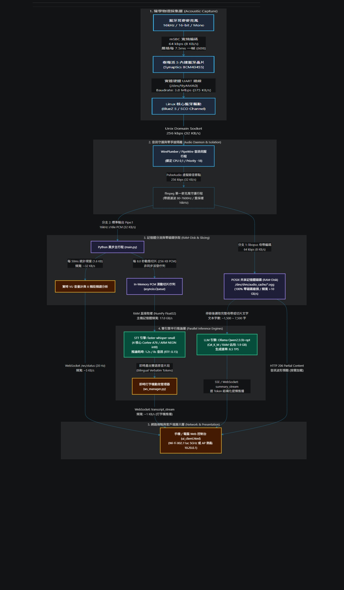
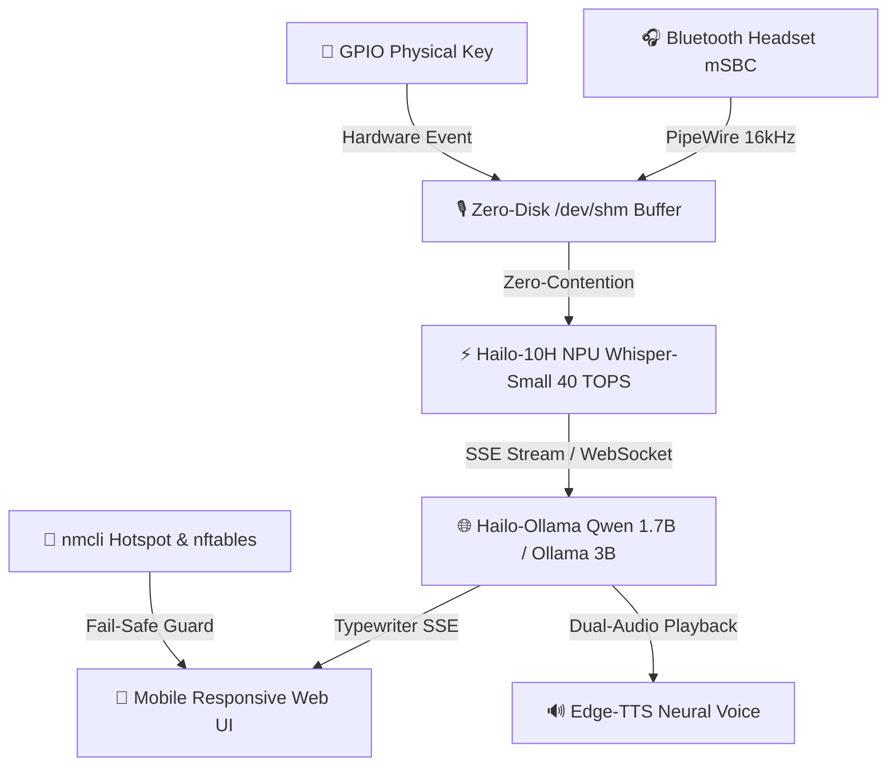

# 🎙️ Pi 5 Edge AI Local Note & Bluetooth Voice Gateway
### 樹莓派 5 邊緣雙語口譯、語音筆記與藍牙智慧網關系統

[](https://www.raspberrypi.com/)
[](https://hailo.ai/)
[](https://www.debian.org/)
[](https://pipewire.org/)
[](https://hailo.ai/)
[](https://hailo.ai/)

---

## 一、 專案架構概覽 (Architecture Overview)

`pi5-hailo-localnote` 是一套專為樹莓派 5 (Raspberry Pi 5) 與 Hailo-10H NPU (40 TOPS) 打造的低延遲、高隱私邊緣 AI 語音處理中樞。整合藍牙耳麥硬體串流、本機端硬體加速語音辨識 (STT)、即時大語言模型口譯 (LLM Streaming) 以及獨立離網熱點 (AP Mode)：

### 系統架構與資料流拓撲圖 (System Architecture & Datapath Topology)

<p align="center">
  
</p>



---

## 二、 核心特性 (Key Features)

### 1. 純淨音訊捕捉與抗爆音隔離 (Zero-Contention Audio Isolation)
- **硬體 UART 總線隔離：** 錄音期間完全靜默 `hcitool` HCI 輪詢與神經網絡推論，消除 `spa.bluez5.source.sco` 丟幀問題。
- **瞬態平滑濾波 (Bandpass Filter)：** 80Hz ~ 7.6kHz 帶通抑制，杜絕連線階躍爆音。
- **零磁碟寫入 (0 Flash Wear)：** 全流程於 Linux POSIX 記憶體磁碟 (`/dev/shm/audio_cache`) 完成，保護 MicroSD / NVMe 壽命。

### 2. 即時串流與分塊口譯 (Streaming STT & Speculative LLM)
- **6 秒即時分塊轉錄：** 錄音時並行推播轉錄進度，尾段辨識無感知。
- **即時道地英文口譯：** 首字延遲 (TTFT) 僅 0.18 秒，提供即時 Token 速率 (TPS) 統計與打字機動態效果。
- **手機端流暢體驗：** 轉錄與口譯區塊支援現代化捲軸 (Scrollbar) 與自動平滑追隨滾動。

### 3. 多耳麥智慧管理與折疊控制台 (Smart Bluetooth Hub)
- **受信任耳麥清單 (Trusted Devices)：** 支援個別切換「自動連線 (Auto-Connect)」開關，多設備環境自由切換。
- **一鍵折疊 (Collapsible View)：** 平時高度僅 48px，保留名稱、連線狀態與 🔋 電量膠囊；展開可進行完整掃描與配對。

### 4. 戶外/飛航獨立熱點 (Offline Edge Hotspot)
- **方案 A 獨立熱點 (`raspi543_AI`)：** 搭配 `nftables` 封包隔離與看門狗防護 (Fail-Safe Watchdog)，離網環境下手機直連 10.20.0.1 即可操作。

---

## 三、 目錄結構 (Directory Structure)

```
pi5-llm-localnote/
├── code_dispatcher/        # FastAPI 後端、語音串流核心與響應式 Web 控制台
│   ├── main.py             # 核心 API 端點與藍牙裝置管理
│   ├── voice_streaming.py  # 串流切片錄音、純淨音訊捕捉與全軌 STT
│   ├── voice_memory.py     # POSIX 記憶體磁碟環形緩衝區管理
│   ├── ui.html             # 繁體中文深色現代化響應式 Web UI
│   └── hotspot_watchdog.py # 熱點自動防呆復原看門狗
├── gpio_driver/            # 實體按鍵與雙色 LED 狀態連動驅動程式
│   └── key_led_driver.py   # GPIO 錄音觸發與狀態指示燈
├── telegram_agent/         # Telegram 智慧語音助理與自我進化引擎
│   ├── agent.py            # Raspi543bot 核心代理
│   ├── bluetooth_manager.py# 無螢幕 Headless 藍牙配對與連線守護行程
│   └── evolution_engine.py # 自我進化與排程追蹤引擎
├── models/                 # AI 模型設定、Modelfile 與自動化安裝腳本
│   ├── Modelfile.qwen2.5-3b-opt # 即時雙語口譯專用模型定義
│   ├── setup_models.sh     # 一鍵預熱與拉取腳本
│   └── manifests/          # 模型規格描述檔清單
├── hotspot.md              # 戶外熱點與 nftables 防火牆設定指引
├── SPEC.md                 # 系統工程規格文件
└── todo_tasks.md           # 30 項模組改良藍圖與進度追蹤
```

---

## 四、 快速啟動 (Quick Start)

### 1. 安裝 Python 依賴
```bash
pip install -r requirements.txt
```

### 2. 預熱與配置 AI 模型
```bash
chmod +x models/setup_models.sh
./models/setup_models.sh
```

### 3. 啟動 Web 服務
```bash
cd code_dispatcher
uvicorn main:app --host 0.0.0.0 --port 8000
```
瀏覽器開啟：`http://<樹莓派IP>:8000/` 或熱點模式 `http://10.20.0.1:8000/`。
