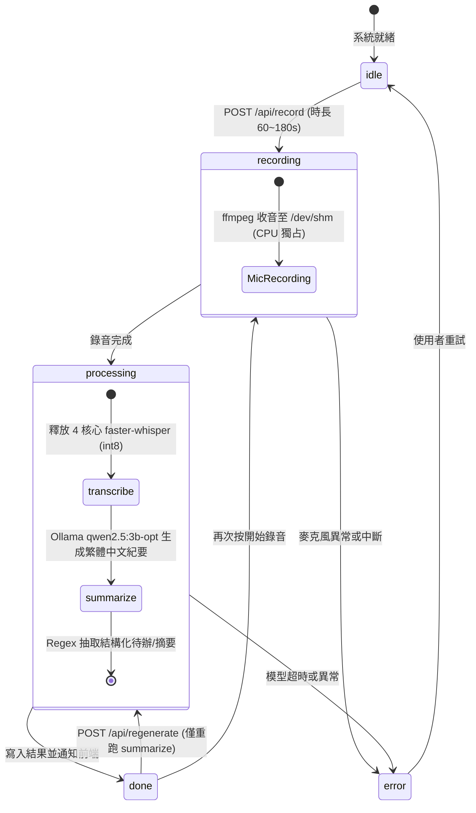

# 規格文件 (SPEC.md): Task 31 - LocalNote 聽記盒 Demo 版 API 適配層與狀態機規格
# (Meeting Minutes Engine & Demo UI Backend Adapter)

> **版本 (Version):** 1.1.0  
> **模組路徑 (Module Path):** `code_dispatcher/meeting_minutes.py`, `code_dispatcher/main.py`  
> **建立日期 (Date):** 2026-10-12  
> **架構師 (Architect):** Senior Staff Software Engineer  

---

## 1. 背景與目標 (Background & Objectives)

為滿足「LocalNote 聽記盒」面向客戶與投資人的展示需求，後端需提供一套符合前端 `LocalNote-工程版-index.html` 規格的極簡、高效且符合硬體零爭搶規範的 API 接口層。

### 核心原則：
1. **零爭搶 (Zero-Contention SCO Guard):** 錄音進行中嚴禁推論與高頻 HCI 指令，保障 7.5ms SCO 音訊傳輸不掉幀。
2. **非阻塞離線探測 (Non-blocking Offline Probing):** 後端背景排程非同步 ping 外網，快取離線狀態，避免輪詢 `/api/system` 造成延遲卡頓。
3. **非同步狀態機 (Async State Machine):** 管理 `idle -> recording -> processing (transcribe -> summarize) -> done / error` 生命週期。
4. **結構化紀要解析與降級保護 (Structured Minutes Parser & Graceful Degradation):** 將本地 LLM (`qwen2.5:3b-opt`) 生成的 Markdown 紀要精確拆解為 `summary[]`, `todos[]`, `decisions[]`，同時提供完整 Markdown 文本。

---

## 2. API 介面規格 (API Interface Specifications)

| 方法 | 路徑 | 請求主體 (Payload) | 回傳格式 (Response) | 說明 |
|---|---|---|---|---|
| `GET` | `/api/system` | — | `{offline, cpu, temp, mode, ssid, host, wifi_qr}` | 每 2 秒輪詢；讀取記憶體快取 |
| `GET` | `/api/bt` | — | `{connected, name}` | 每 5 秒輪詢；錄音時讀取快取 |
| `POST` | `/api/bt/{action}` | — | `{ok, msg}` | 支援 `scan`, `connect`, `disconnect` |
| `POST` | `/api/record` | `{seconds: int}` | `{job: str}` | 啟動非同步錄音與後續處理任務 |
| `GET` | `/api/status` | — | `{state, phase, progress, elapsed, total, eta, job, msg}` | 狀態輪詢（1.5s/次） |
| `GET` | `/api/result` | — | `{job, title, started_at, duration, summary[], todos[], decisions[], transcript, markdown}` | 取得最終或階段性產出 |
| `POST` | `/api/regenerate` | — | `{job: str}` | 僅重新執行 LLM 紀要生成，不重錄 |
| `POST` | `/api/translate` | `{text: str, to: "en"\|"zh"}` | `{text: str}` | 紀要雙向翻譯 |
| `POST` | `/api/tts` | `{text: str}` | `{ok: bool}` | 耳麥語音朗讀合成 |
| `POST` | `/api/net/switch` | `{mode: "ap"\|"sta"}` | `{ok: bool}` | 熱點/家用 Wi-Fi 雙向原子切換 |

---

## 3. 狀態機與處理流水線設計 (State Machine Pipeline)

---

## 4. 實作檢查清單 (Implementation Checklist)

- [x] **Phase 1-A: 撰寫架構規格與驗證避坑條件 (SPEC.md)**
- [ ] **Phase 1-B: 實作會議錄音與紀要管理引擎 (`code_dispatcher/meeting_minutes.py`)**
  - 非同步狀態機與背景作業管理。
  - 後端非阻塞離線偵測守護行程 (Background Offline Ping Watchdog)。
  - 提示詞工程 (Prompt Engineering) 與 Markdown 結構化解析器。
- [ ] **Phase 1-C: 在 `code_dispatcher/main.py` 整合並註冊 10 個標準 API 端點**
  - 重用 `voice_pipeline.py`、`bluetooth_manager.py` 與 `hotspot_controller.py`。
  - 全面相容既有 `/api/voice/...` 與 `/dbg01` 路由。
- [ ] **Phase 1-D: 靜態 Wi-Fi QR Code 產生與路由掛載 (`static/wifi_ap.png`)**
- [ ] **Phase 1-E: 單元測試與 API 模擬驗證 (`test_meeting_minutes.py`)**
